# GameScene 그래픽 최적화 전후 비교

브랜치: `perf/graphics-optimization` · 측정일: 2026-10-30 · Unity 6000.3.22f1 (URP 17.3), 에디터 Play 모드, Game 창 1046×373

## 측정 방법

- 카메라 추종 스크립트(`CameraViewSwitcher`, `CameraFollow`, `CameraRotate`)를 끄고, 메인 카메라를 고정된 세 시점에 둔 뒤 약 2초 후 측정했다.
- `*_stats.png`는 Stats 오버레이가 켜진 Game 창을 화면 그대로 캡처한 것이고, 수치는 같은 프레임의 `UnityEditor.UnityStats` 값이다(`stats.jsonl`).
- 측정 헬퍼: `AgentScripts/GraphicsBenchmark.cs` (Assets 밖이라 빌드에 포함되지 않음)

| 시점 | 위치 / 회전 | 보려는 것 |
|---|---|---|
| view1_street | (0, 1.7, -3) / (5, 90, 0) | 지상 원경. LOD, 그림자 |
| view2_overview | (-50, 45, -85) / (25, 45, 0) | 맵 전체 조감. LOD 컬링, 그림자 거리 |
| view3_behind_hangar | (20, 1.7, 16) / (0, 90, 0) | 격납고 벽 바로 앞. 오클루전 컬링 |

## 수치 비교

| 시점 | 항목 | 전 | 후 | 변화 |
|---|---|---:|---:|---:|
| view1_street | Tris | 5,232,106 | 1,129,264 | **-78.4%** |
| | Verts | 3,233,638 | 793,572 | -75.5% |
| | Batches | 373 | 335 | -10.2% |
| | SetPass calls | 99 | 79 | -20.2% |
| | Draw calls | 895 | 587 | -34.4% |
| | Shadow casters | 576 | 17 | **-97.0%** |
| view2_overview | Tris | 7,204,020 | 2,148,755 | **-70.2%** |
| | Verts | 4,344,544 | 1,450,053 | -66.6% |
| | Batches | 330 | 283 | -14.2% |
| | SetPass calls | 91 | 78 | -14.3% |
| | Draw calls | 904 | 708 | -21.7% |
| | Shadow casters | 204 | 0 | **-100%** |
| view3_behind_hangar | Tris | 5,174,439 | 1,037,432 | **-79.9%** |
| | Verts | 3,163,786 | 656,702 | -79.2% |
| | Batches | 283 | 131 | **-53.7%** |
| | SetPass calls | 82 | 64 | -22.0% |
| | Draw calls | 679 | 163 | **-76.0%** |
| | Shadow casters | 464 | 0 | **-100%** |

> FPS / CPU main 시간은 전후 모두 약 11~14ms로 차이가 없었다. 에디터 Play 모드에서는 에디터 자체 오버헤드가 프레임 시간을 대부분 차지하고 FPS도 측정마다 흔들리므로, 프레임 시간 개선은 빌드 + Profiler로 따로 확인해야 한다.

## 스크린샷

### view1_street

| 전 | 후 |
|---|---|
| 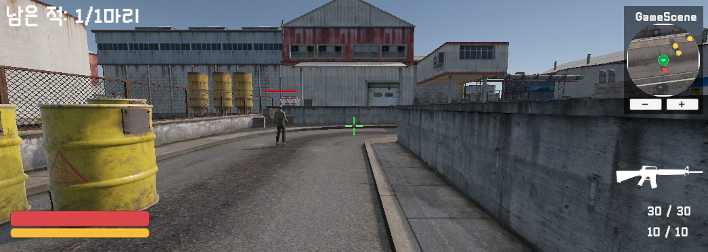 | 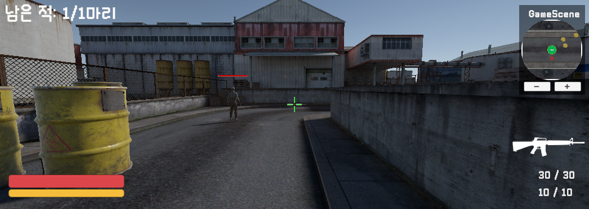 |
| 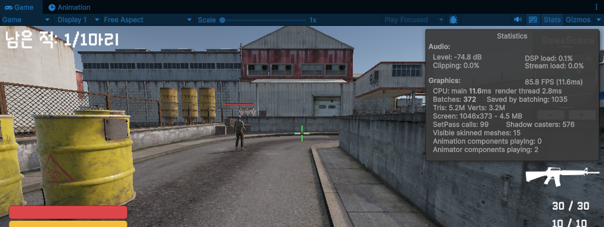 | 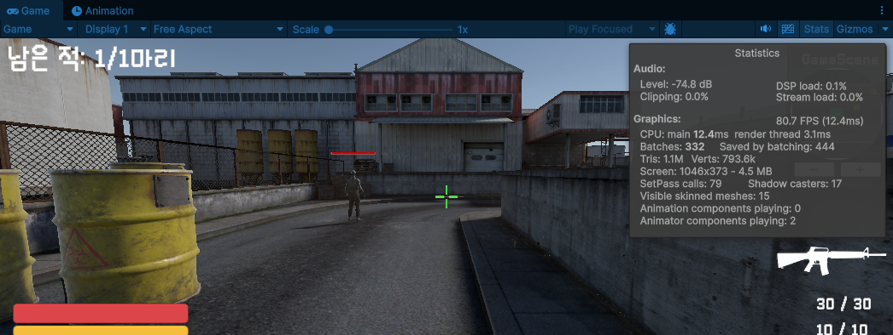 |

### view2_overview

| 전 | 후 |
|---|---|
| 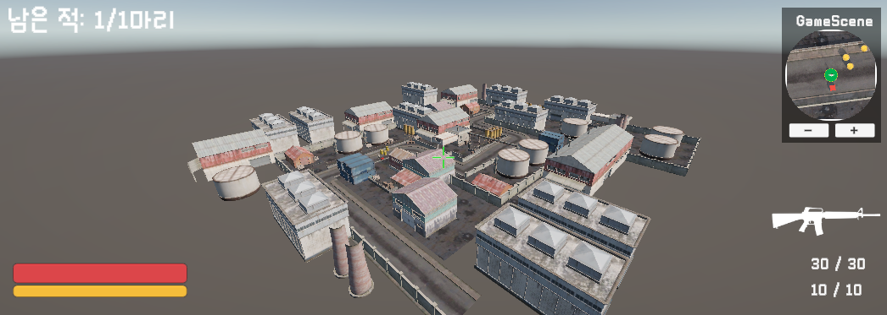 | 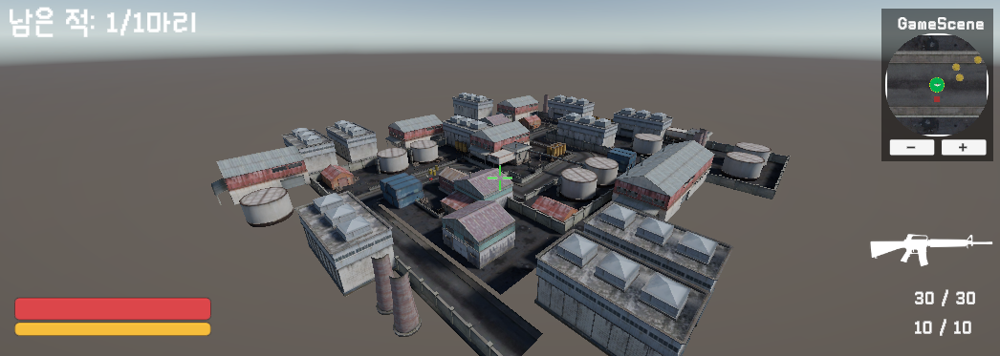 |
| 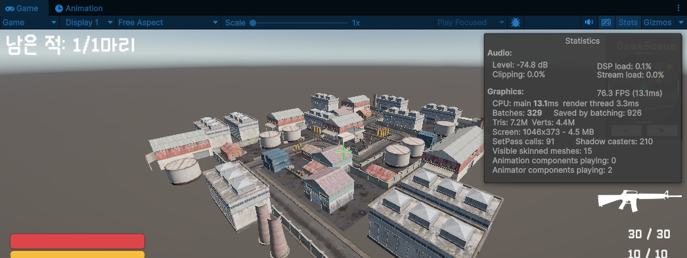 | 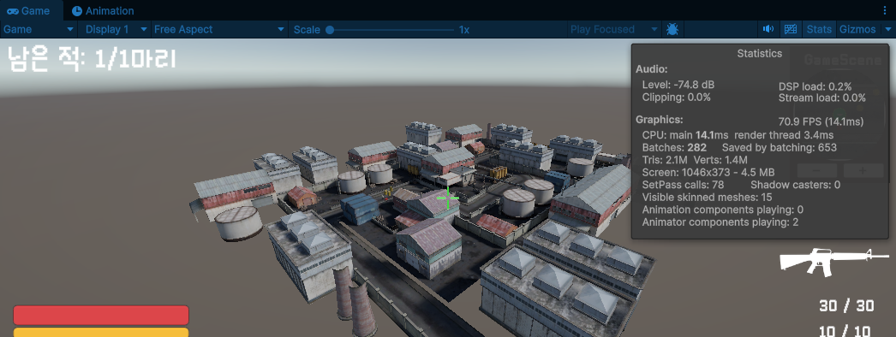 |

### view3_behind_hangar

| 전 | 후 |
|---|---|
| 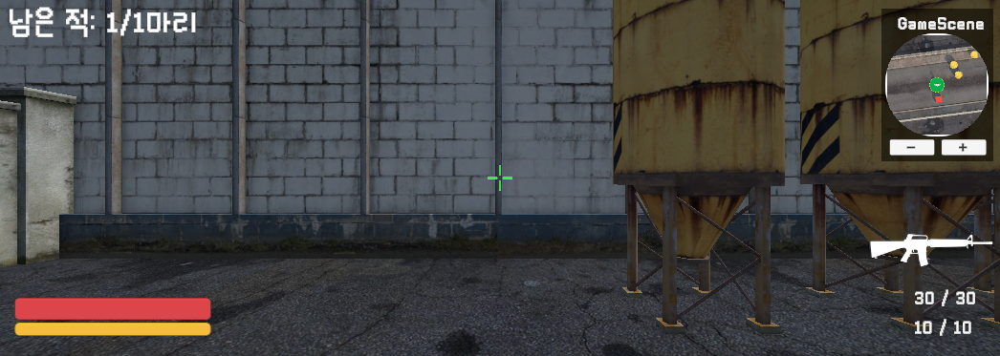 | 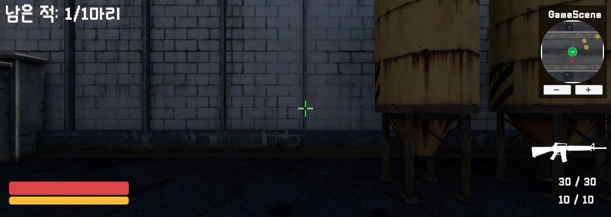 |
| 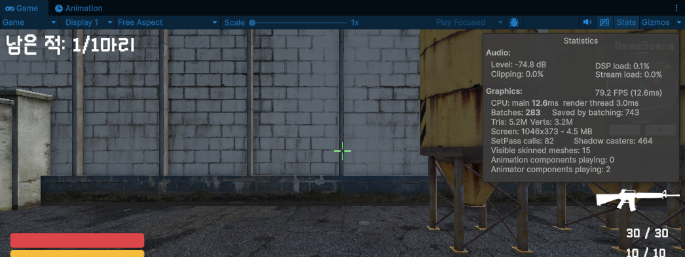 | 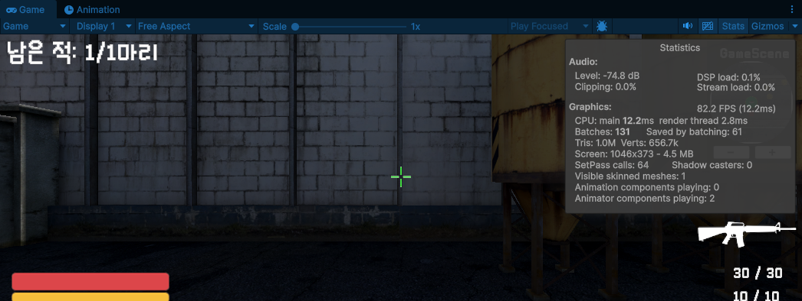 |

view3에서 "Visible skinned meshes"가 15 → 1로 줄었다. 격납고 벽 뒤에 있는 좀비가 오클루전 컬링으로 그려지지 않은 것이다.

## 적용 내용

| 단계 | 내용 |
|---|---|
| 라이트 정리 | 중복 Directional Light 2개 중 루트의 Realtime 라이트(세기 2)를 끄고 `Map/Map_v1/Light/Directional Light`(Mixed, 세기 1.5)만 남김 |
| 오클루전 컬링 | 정적 렌더러 402개를 크기로 분류: 큰 건물·벽·펜스·컨테이너 111개는 Occluder+Occludee, 소품·바닥·격자 펜스·배관은 Occludee만. Smallest Occluder 2 / Smallest Hole 0.25 / Backface 100으로 베이크. 미니맵 카메라는 Occlusion Culling 끔 |
| LOD Group | 컨테이너 14개: LOD0 `LD2close`(132 tris) → LOD1 `LD1close`(12 tris, 25%) → Culled(1%). 작은 소품 133개(팔레트, 상자, 드럼통, 에어컨, 환풍구, 바리케이드, 전기함 등): LOD0 → Culled(2%) |
| Mesh LOD | `Kal.fbx`(500,000 → 64 tris, 15단계), `Post-Apocalyptic Barrels.fbx`(2,038 → 64 tris, 6단계) Generate Mesh LODs 켬 |
| 셰도우 마스크 | `GameScene_LightingSettings.lighting` 생성(Baked GI, Mixed Lighting = Shadowmask, Progressive GPU, 8 texel/unit, 최대 2048). Quality(Mobile/PC) Shadowmask Mode = Shadowmask. 라이트맵 3장 + 셰도우마스크 3장. 동적 오브젝트용 라이트 프로브 2,781개(4m 간격, 바닥 위 0.3/2/5m) |
| 그림자 컬링 | PC_RPAsset Shadow Distance 50 → 30, Cascade 4 → 2. 미니맵 카메라 Render Shadows 끔. 칼 Cast Shadows 끔. Shadowmask 모드라 정적 오브젝트는 실시간 그림자를 그리지 않음 |

## 화면 차이 (주의할 점)

- 라이트가 하나 줄어서 Realtime 라이트가 비추던 면이 어두워졌다. 특히 view3의 벽이 눈에 띄게 어두워졌다. 밝기를 원래와 비슷하게 맞추려면 Mixed 라이트 세기를 올리고 다시 베이크해야 한다.
- 정적 오브젝트의 그림자가 베이크된 셰도우마스크로 바뀌어서, 실시간 그림자보다 경계가 부드럽고 해상도가 낮다.

## 진행 중 발견하고 수정한 문제

- 처음에는 라이트 프로브를 8m 간격 2층으로 배치했는데, 도로와 인도의 높이 차 때문에 프로브 공간 바닥이 기울었다. 그 아래에 있는 동적 오브젝트(플레이어, Box)에서 외삽값이 폭주해(SH 계수 최대 약 5천만) 화면이 하얗게 번쩍였다.
- 4m 간격 3층으로 다시 배치했다. 맵 전체의 걸을 수 있는 지점(1m 간격, 높이 0.1~8m, 약 7만 4천 곳)에서 보간값을 검사해 폭주 0건(최대 계수 0.45)을 확인했다. 배치·검증 헬퍼: `AgentScripts/SetupLightProbes.cs`

## 남은 개선 여지 (이번에 적용하지 않음)

- **플레이어 모델 `WonSoongi`(스킨드 메시 500,000 tris)가 미니맵 카메라에 그려진다.** view3의 남은 Tris 약 100만이 거의 다 여기서 나온다. 미니맵 카메라를 끄면 19,359 tris까지 내려간다. 미니맵은 플레이어를 아이콘(`MinimapIcon`)으로 표시하므로, 모델 렌더러를 미니맵 Culling Mask에 없는 `Player` 레이어로 옮기면 사라진다. 다만 레이어를 바꾸면 레이캐스트나 충돌 판정에 영향이 갈 수 있어서 확인 후 적용해야 한다.
- `Kal`/`WonSoongi` 원본 메시의 폴리곤 수 자체를 줄이는 것이 근본적인 해결이다. 1인칭에서는 칼이 항상 카메라 가까이 있어서 Mesh LOD0으로 그려진다.
- 레이어별 그림자 컬링(`Light.layerShadowCullDistances`)은 좀비 모델 렌더러가 `Default` 레이어에 있어서 적용 대상이 없어 제외했다.
