# GameScene 성능 최적화 (CPU → GPU → 메모리)

브랜치 `perf/graphics-optimization` · 2026-11-02 · Unity 6000.3.22f1 (URP 17.3, DX12) · 에디터 Play 모드, Game 창 1046×373

| 단계 | 커밋 | 한 줄 요약 |
|---|---|---|
| CPU | `fc3af76` (코드) · `44ea2b1` (After 자료) | 좀비 AI의 매 프레임 경로 계산·로그·할당 제거 |
| GPU | `528c699` | 미니맵 카메라의 불필요한 패스 제거, SSAO 절반 해상도, 추가 라이트 그림자 끄기 |
| 메모리 | `1fd898c` | 라이트맵 방향성 텍스처 12장 2048 → 1024 |

## 측정 방법

- 공통 조건: Play 모드에서 게임 상태가 `Playing`이 된 뒤 `spawn_zombies.cs`로 좀비를 40마리로 맞추고, 플레이어는 입력 없이 시작 위치에 둔다.
- 수치: `ProfilerRecorder`로 최근 프레임(최대 300) 값을 모아 avg / p50 / p95를 냈다 → `data/*.json`
- 스크린샷
  - Stats: Stats 오버레이를 켠 Game 창 캡처 → `images/*_stats.png`
  - CPU: Unity Profiler (CPU Usage + Hierarchy) → `images/cpu_*_profiler.png`
  - GPU: Frame Debugger + 전체 이벤트 목록 → `images/gpu_*_framedebugger.png`, `data/gpu_*_framedebugger_events.tsv`
  - 메모리: Memory Profiler 스냅샷(`MemoryCaptures/*.snap`, git 제외) Summary → `images/mem_*_memoryprofiler.png`
- 측정 스크립트: `AgentScripts/bench_*.cs`, `spawn_zombies.cs`, `capture_window.ps1` (Assets 밖에 있어서 빌드에 포함되지 않음)

> ⚠️ 에디터에서 잰 값이다. `Main Thread`에는 EditorLoop가 포함되고 메모리도 에디터 자체 사용량이 섞여 있다. 그래서 비교는 **PlayerLoop, 스크립트 Update, GC 할당, 렌더 패스, 텍스처 메모리**처럼 게임 코드나 에셋에 직접 묶인 지표로 했다. 절대 수치는 빌드에서 다시 재야 한다.

---

## 1. CPU 최적화

### 적용한 기술

| 문제 (Before) | 변경 (After) | 기법 |
|---|---|---|
| 좀비 40마리가 매 프레임 `NavMeshAgent.SetDestination` 호출 | `_repathInterval`(0.2초)마다 한 번만 경로 갱신 (`MoveTo`) | 연산 주기 조절 (Throttling) |
| 상태가 바뀔 때마다 `Debug.Log` (문자열 할당 + 스택 트레이스) | `ChangeState()` → `GameLogger.Log`로 통일, `CameraRotate` 매 프레임 로그 삭제 | 로그 비용 제거 |
| 코루틴마다 `new WaitForSeconds` | `Awake`에서 만든 객체 재사용 | GC 할당 제거 |
| 피격마다 루프 파티클 `Instantiate`, 파괴하지 않아 계속 쌓임 | 좀비당 1개만 만들어 두고 `Stop/Play`로 재사용 | 오브젝트 재사용 |
| `Vector3.Distance` (제곱근) | `sqrMagnitude` 비교 (`IsWithin`) | 산술 비용 절감 |
| `_player.GetComponent<IDamageable>()`를 공격할 때마다 호출, `Camera.main` 매 프레임 조회 | `Start`에서 캐싱 | 참조 캐싱 |
| 체력바를 매 프레임 갱신 | `OnHit` 이벤트 때만 갱신 | 이벤트 기반 갱신 |

변경 파일: `Zombie.cs`, `ZombieHealthBar.cs`, `PlayerGunFire.cs`, `PlayerZoom.cs`, `Player.cs`, `UI_HitEffect.cs`, `UI_PlayerStats.cs`, `CameraRotate.cs`

### 결과 (좀비 40마리)

| 지표 | Before | After | 변화 |
|---|---:|---:|---:|
| PlayerLoop (avg) | 9.38 ms | 4.82 ms | **-48.6%** |
| 스크립트 Update (BehaviourUpdate, avg) | 0.614 ms | 0.153 ms | **-75.1%** |
| 프레임당 GC 할당 (p50) | 71.6 KB | 57.4 KB | -19.8% |
| 프레임당 GC 할당 (avg) | 104.3 KB | 84.2 KB | -19.3% |
| GC.Collect 최대 스파이크 | 8.76 ms | (After 측정 항목에서 누락) | - |
| Profiler 스크린샷의 PlayerLoop (한 프레임) | 10.55 ms | 4.94 ms | -53% |
| Draw Calls (avg, 참고) | 1,981 | 1,728 | 조건이 비슷한지 확인용 |

### 스크린샷

| Before | After |
|---|---|
| 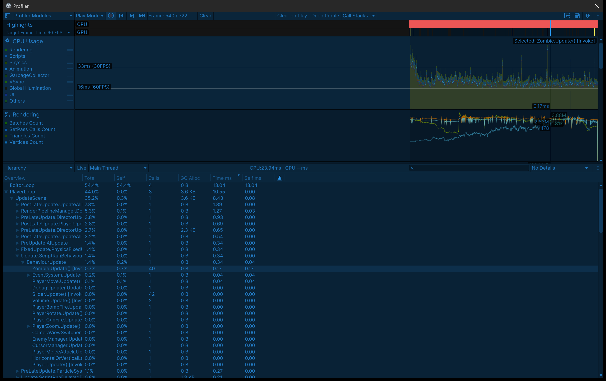 | 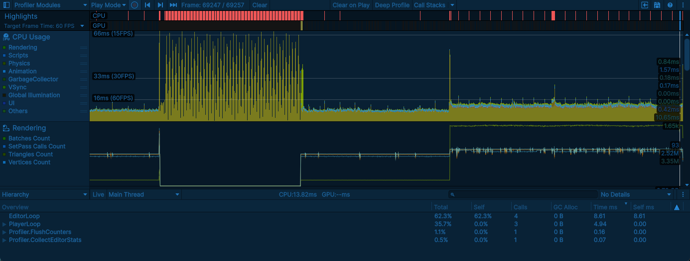 |
| 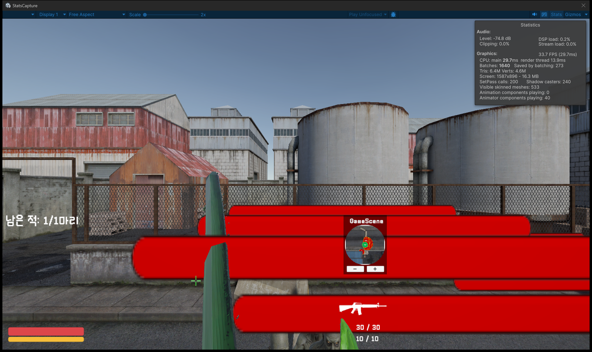 |  |
|  | 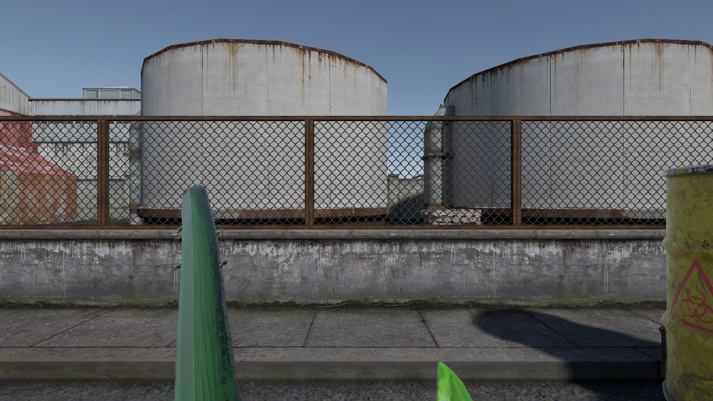 |

- Profiler Before: `PlayerLoop 10.55ms`, `Zombie.Update()` 40회 호출 0.17ms
- Profiler After: `PlayerLoop 4.94ms`, `EditorLoop 8.61ms`. 나머지는 에디터 비용이다.

### 분석

- PlayerLoop가 절반 정도로 줄었다. 가장 큰 원인은 경로 재계산을 줄인 것이다. 좀비 40마리 × 매 프레임 `SetDestination`이 0.2초에 한 번으로 줄었다. 그다음은 `Debug.Log` 제거다. 에디터에서는 로그 한 줄마다 스택 트레이스를 수집하므로 비용이 크다.
- 프레임당 GC 할당이 약 20% 줄었으므로 GC.Collect 발생 빈도도 낮아질 것으로 예상한다. After 측정에서 GC.Collect 마커를 기록하지 않아서 스파이크를 직접 비교하지는 못했다.
- 남은 할당 57KB/프레임은 대부분 에디터와 UI 쪽이다. 더 줄이려면 Profiler의 GC Alloc 열로 호출 위치를 추적해야 한다.
- 한계: Before는 이전 세션에서 측정했다(600프레임). 에디터 창 배치가 달라서 `Main Thread`(25.3 → 13.9ms)는 그대로 비교하지 않는다.

---

## 2. GPU 최적화

### 적용한 기술

| 대상 | Before | After | 이유 |
|---|---|---|---|
| 미니맵 카메라 Depth/Opaque Texture | 파이프라인 설정 따름 (On) | **Off** | 256×256 미니맵에 `_CameraOpaqueTexture`나 깊이 텍스처를 쓰는 셰이더가 없다. 그런데도 CopyColor와 최종 Blit 패스가 돌고 있었다. |
| 추가 라이트 그림자 (`PC_RPAsset`) | On (2048 아틀라스) | **Off** | 실시간 Point Light 그림자는 큐브맵 6면을 렌더링한다. 나머지 라이트는 Baked라 영향이 없다. |
| SSAO (`PC_Renderer`) | Full 해상도 | **Downsample (1/2)** | AO는 저주파 효과라 해상도를 절반으로 내려도 화질 차이가 작다. SSAO 픽셀 연산은 약 1/4로 줄어든다. |

Opaque Texture 자체는 끄지 않았다. 메인 카메라의 Slash VFX 셰이더(`Impact`, `Slash`, `Slash World`)가 SceneColor를 사용하기 때문이다.

### 결과: Frame Debugger (`data/gpu_*_framedebugger_events.tsv`)

| 항목 | Before | After |
|---|---:|---:|
| 전체 렌더 이벤트 | 230 | **226** |
| ClearColor | 2 | 1 |
| DrawProcedural (Blit/Copy) | 29 | 27 |
| 미니맵 카메라 `CopyColor` | 있음 | **없음** |
| 미니맵 카메라 `BlitFinalToBackBuffer` | 있음 | **없음** (RT에 바로 렌더) |
| 미니맵 카메라 중간 버퍼 Clear | 있음 | **없음** |

| Before | After |
|---|---|
| 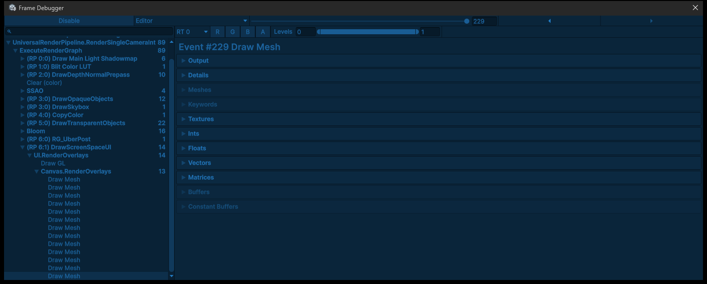 | 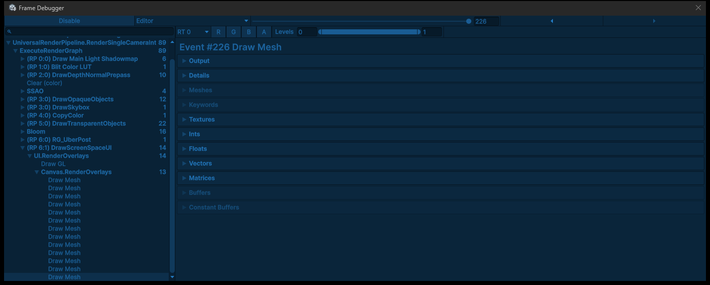 |
| 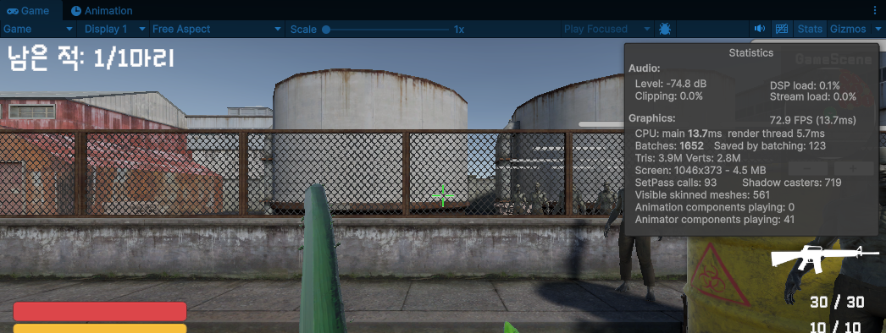 | 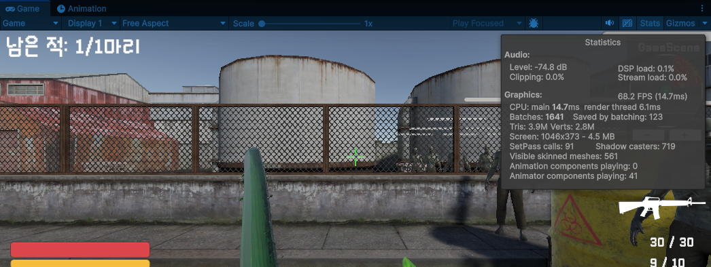 |

(스크린샷은 메인 카메라 부분이다. 미니맵 카메라 이벤트는 위 표와 tsv 파일에 있다.)

### 결과: Profiler / Stats (좀비 40마리)

| 지표 | Before | After |
|---|---:|---:|
| GPU Frame Time (avg / p50) | 5.82 / 7.38 ms | 6.76 / 7.72 ms |
| Render Thread (avg) | 2.81 ms | 2.88 ms |
| SetPass Calls (p50) | 93 | 91 |
| Batches (p50) | 1,642 | 1,637 |

### 분석

- 미니맵 카메라에서 쓸모없던 패스 3개(CopyColor, Final Blit, Clear)가 빠진 것은 Frame Debugger 이벤트 diff로 확인했다.
- GPU Frame Time은 **에디터 측정 오차 범위 안이라 개선이라고 볼 수 없다.** 이유는 세 가지다. ① Game 창이 1046×373으로 작아서 SSAO 해상도를 줄여도 절대 비용 차이가 작다. ② 측정 시점에 실시간 Point Light 범위 안에 그림자 캐스터가 없어서 추가 라이트 그림자 패스가 원래 생성되지 않았다. ③ 에디터 GPU 시간에는 Scene/에디터 UI 렌더링이 섞인다.
- 따라서 이번 GPU 변경은 "쓸모없는 작업 제거"로 보고, 실제 효과는 FHD 이상 해상도의 빌드에서 Point Light 근처를 측정해야 확인할 수 있다.
- 화질: SSAO Downsample로 접촉 그림자 경계가 조금 부드러워질 수 있다. 실시간 Point Light 그림자가 사라진다. Stats 스크린샷의 게임 화면으로 비교하면 된다.

---

## 3. 메모리 최적화

### 적용한 기술

| 대상 | Before | After |
|---|---|---|
| 라이트맵 방향성 텍스처 `Lightmap-*_comp_dir.png` 12장 | 2048×2048 DXT5 | **1024×1024** DXT5 (임포트 Max Size만 변경) |

방향성(Directional) 라이트맵은 노멀맵 디테일에 쓰는 "빛이 들어오는 방향"을 담는다. 공간적으로 천천히 변하는 데이터라 해상도를 절반으로 내려도 눈에 띄는 차이가 거의 없다. 반면 메모리는 1/4로 준다. 조명 색 자체(`_comp_light.exr`)는 그대로 두었다.

### 결과

| 지표 | Before | After | 변화 |
|---|---:|---:|---:|
| 방향성 라이트맵 12장 메모리 (`Profiler.GetRuntimeMemorySizeLong`) | 128.5 MB | 32.5 MB | **-96.0 MB (-75%)** |
| Profiler `Texture Memory` | 792.7 MB | 714.9 MB | **-77.8 MB (-9.8%)** |
| Memory Profiler `Texture2D` | 0.55 GB | 470.7 MB | 약 -90 MB |

| Before | After |
|---|---|
| 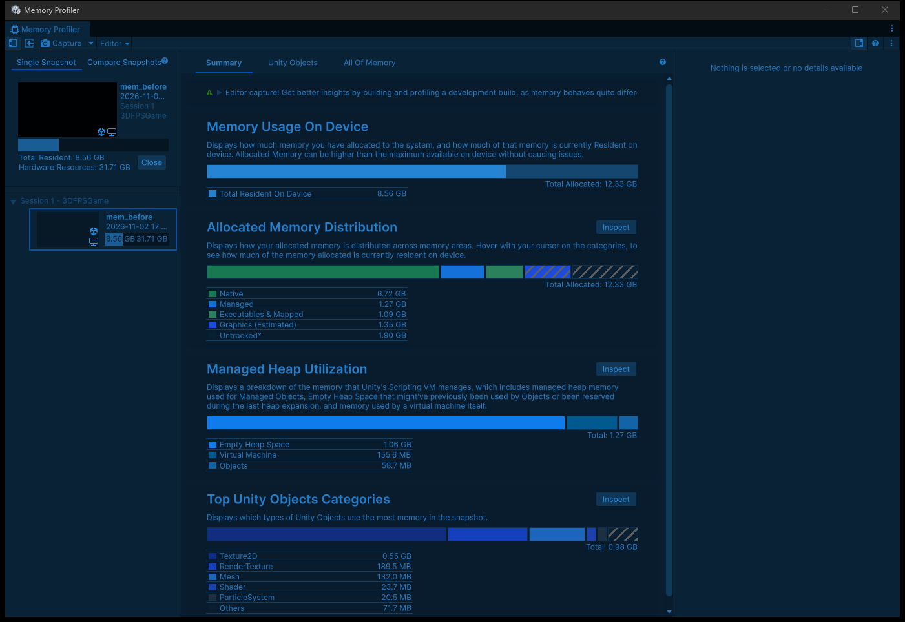 | 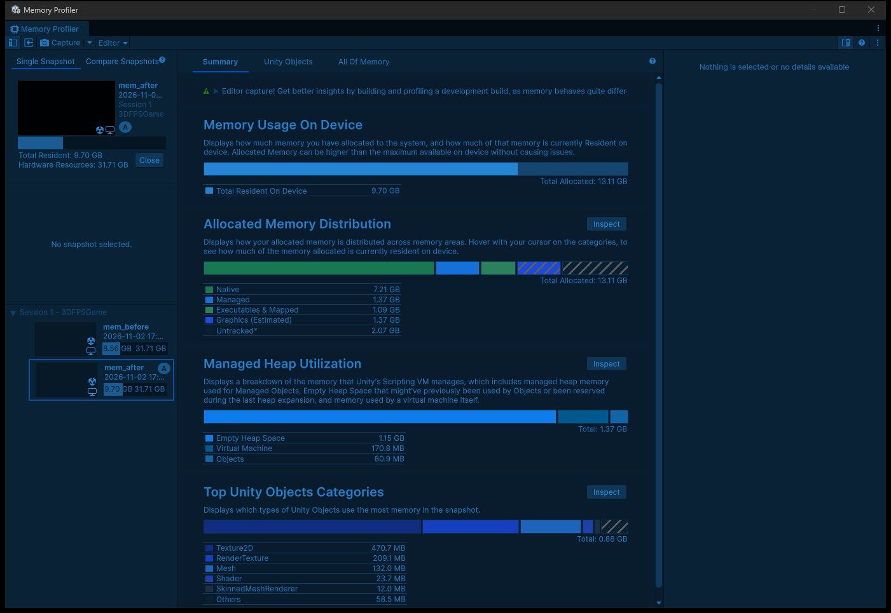 |
| 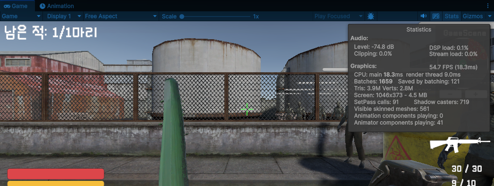 | 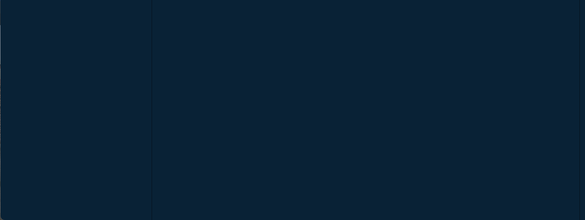 |

비교 화면: 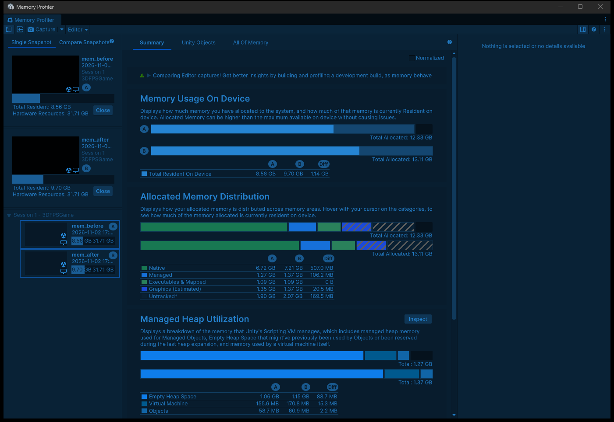

- Memory Profiler Before의 Top Unity Objects: Texture2D 0.55GB, RenderTexture 189.5MB, Mesh 132.0MB, Shader 23.7MB
- Memory Profiler After의 Top Unity Objects: **Texture2D 470.7MB**, RenderTexture 209.1MB, Mesh 132.0MB, Shader 23.7MB

### 분석

- 텍스처 메모리가 약 80~96MB 줄었다. 에디터 값이고 CPU 사본이 포함된 수치라, 빌드에서는 GPU 메모리 기준 약 48MB(12장 × 4MB) 감소가 예상된다.
- **Total Resident(8.56 → 9.70GB)가 오히려 늘어난 것은 최적화 결과가 아니다.** After 스냅샷을 찍을 때 에디터 프로세스에 Memory Profiler 창과 첫 스냅샷(1.5GB 파일) 분석 데이터가 올라와 있었다. 그래서 Native/Untracked가 함께 늘었다. 에디터 캡처에서는 Total 대신 카테고리별 값(Texture2D)을 비교해야 한다.
- 주의: 라이트맵을 다시 굽으면 Unity가 라이트맵 임포트 설정을 다시 쓸 수 있다. 다시 구운 뒤 Max Size를 확인해야 한다. 근본적인 방법은 Lighting 설정의 Max Lightmap Size나 Directional Mode를 조정하고 다시 굽는 것이다.
- 한계: mem_after 측정 때 좀비 복제가 실패해서 좀비가 1마리였다(Draw Calls 240). 텍스처 메모리는 좀비 수와 상관없지만, mem_after의 Stats/CPU 수치는 다른 표와 비교하면 안 된다.

---

## 요약

| 영역 | 핵심 지표 | Before → After |
|---|---|---|
| CPU | PlayerLoop | 9.38 → 4.82 ms (**-49%**) |
| CPU | 스크립트 Update | 0.614 → 0.153 ms (**-75%**) |
| CPU | 프레임당 GC 할당 (p50) | 71.6 → 57.4 KB (-20%) |
| GPU | 렌더 이벤트 | 230 → 226 (미니맵 CopyColor/Blit/Clear 제거) |
| GPU | GPU Frame Time | 변화 없음 (에디터 오차 범위) |
| 메모리 | Texture Memory | 792.7 → 714.9 MB (**-78 MB**) |

다음에 할 일: 개발 빌드(FHD)에서 Profiler를 연결해 GPU Frame Time과 메모리 절대값을 다시 잰다. 폰트 SDF 아틀라스(4096², 에디터 기준 32MB)는 다음 메모리 최적화 후보다.
